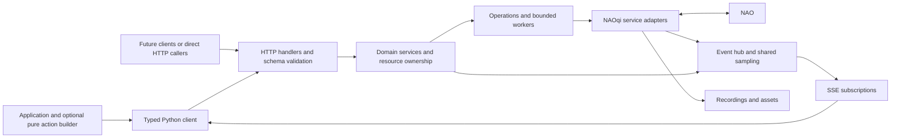

# NAO Bridge API plan

Status: implementation plan, 6 November 2026. The direction reflects Dave's decisions; numerical defaults and hardware-dependent details below are design targets to validate during delivery. None of the new endpoints or examples in this document is implemented yet.

Read alongside the [delivery plan](delivery-plan.md), [client contract guide](client-contract.md), and [research evidence](research-notes.md).

## 1. Product boundary

NAO Bridge exposes a language-neutral HTTP/SSE API for observing and controlling one NAO. Python is its first client. Applications should learn robot concepts, not NAOqi proxy conventions, native task IDs, ALMemory keys, or FluentNao's execution machinery. A future Rust client for a Tauri Recorder must be implementable from the published contract without reading or running the Python client. Additional clients and a Tauri application are outside the four-increment implementation scope.

The three acceptance applications are:

1. A pose and animation recorder: select joints, adjust stiffness, capture measured poses, use touch or voice to trigger recording, edit a timeline, and replay it reliably.
2. A wanderer: read obstacles and odometry, react to touch and detections, move and stop, capture images, and maintain its own map and planner.
3. A presentation: control autonomous behavior, coordinate speech, gestures, and lighting, and report what actually completed.

One bridge serves one robot; an application creates multiple clients for multiple robots. No central broker or fleet service is required.

There is no v1 compatibility layer, old-client migration requirement, or FluentNao compatibility requirement. Replace existing code where that simplifies the design. Keep credits and licensing when reusing source.

The public surface covers common motion, sensing, expression, perception, and media tasks. It deliberately excludes generic NAOqi method invocation, arbitrary Python execution, arbitrary ALMemory reads/writes, footstep planning, whole-body optimization, low-level actuator access, robot administration, package installation, and a general scripting language. Cartesian manipulation and robot-hosted mapping/navigation are outside this plan. Add such capabilities only for a concrete application need, using the same domain vocabulary.

## 2. Concepts and naming

| Concept | Meaning |
| --- | --- |
| Robot | Identity, discovered hardware, connection, and supported capabilities. |
| State | An observation with provenance, freshness, and connection generation. |
| Command | A validated request to change the robot; finite commands create operations. |
| Operation | The observable lifetime and outcome of a command. |
| Session | A client's ownership and cleanup boundary; explicit over HTTP, optionally managed by an SDK. |
| Subscription | A filtered SSE feed of events and optional sampled state. |
| Activity | A managed ongoing producer, such as a speech listener or face observation. |
| Asset | A downloadable recording, image, or uploaded audio file. |
| Sequence | A finite, declarative composition of commands and delays. |

Use domain nouns: `robot`, `motion`, `speech`, `sensors`, `vision`, `audio`, `lights`, `behaviors`, `autonomy`, `events`, `recordings`, and `sequences`. Use American spelling consistently in the new wire API and Python client. Native joint names are discovered identifiers, not a second command vocabulary.

## 3. Shared contract

### HTTP and schemas

- The new root is `/api`. Publish `contract_version` in `/api/robot` and in the schema. It starts at `1.0.0` for this replacement contract; this is unrelated to the removed `/api/v1` routes.
- Publish OpenAPI at `/api/openapi.json`, event and sequence payload schemas with it, and a human reference at `/docs`. All examples below omit the `/api` prefix.
- JSON uses UTF-8 and `snake_case`. Resources are objects, collections are `{ "items": [...], "next_cursor": null }`. No redundant `success: true` wrappers.
- Successful reads return 200. Resource creation returns 201 and `Location`; command acceptance returns 202, an Operation, and its `Location`. Deletion returns 204 after cleanup is confirmed; potentially slow stops use an operation instead.
- Reject unknown request fields, nonfinite numbers, invalid combinations, and unsupported options. Never silently clamp a motion target or substitute a different behavior. Clients tolerate additive response fields.
- Versioned, language-neutral OpenAPI and JSON Schema documents are the canonical contract. Give every endpoint a stable unique `operationId` and every public payload a named schema. Tooling may be written in Python, but Python classes are not an independent source of truth. The Python 2 server uses compatible validation code and generated/static schema artifacts; do not introduce a modern runtime dependency into that container to serve documentation.
- Paginate operation and asset history. Bound request sizes, sequence length, trajectory size, subscription count, recording size, and concurrent activities. Advertise limits in capabilities and return actionable limit errors.

### Language-neutral behavior and evolution

The server implements domain defaults, validation, resource ownership, trajectory execution, and sequence scheduling for every caller. SDKs may add early validation and ergonomic helpers, but cannot supply otherwise-missing robot semantics. An OpenAPI `default` is documentation unless the server actually applies it; direct HTTP tests must verify omitted-field behavior.

Schemas define required versus optional fields, permitted null values, numeric bounds/units, timestamp precision, collection ordering, and explicit discriminator fields for event/action/result variants. Keep identifiers and replay cursors opaque strings. Use finite JSON numbers for measurements; integer counters are bounded to the exactly representable range 0–9007199254740991 unless a narrower range is specified. Unbounded counters, if needed, use a documented decimal-string representation. Avoid Python-specific serialization, coercion, object tags, or positional tuples masquerading as objects. The [client guide](client-contract.md) defines wire-level lifecycle and extension behavior.

Publish immutable contract bundles with the container/client release, including OpenAPI, referenced payload schemas, examples, and conformance fixtures. Contract version is independent of package/image version. Within a major version, minor releases may add endpoints, optional fields, request options, and explicitly extensible variants; patch releases must not change observable semantics. Removing/renaming fields, changing units/defaults or requiredness, changing nullability, changing lifecycle semantics, or extending a closed response enum requires a major version. Correcting implementation drift to match the published contract is a bug fix, with release notes for affected callers.

Clients check discovery before control, reject unsupported contract majors, and use capability discovery for optional features rather than assuming them from a version number. Closed lifecycle enums include operation states and state-quality values; unknown values are protocol errors, never guessed success. Event types and error codes are explicitly extensible: preserve unknown values and handle them generically. Unknown event types cannot trigger robot actions. Existing fields retain their meaning, and unknown response fields are tolerated. Requests still reject unknown fields, so clients must not send newer options without support evidence.

This is a compatibility policy for future clients of the replacement API. It does not require supporting old `/api/v1`, existing FluentNao behavior, concurrent contract majors, or a new Rust client now.

### Units and coordinates

- Distances: meters. Rotations: radians. Duration: seconds. Velocity: meters/second and radians/second. RGB colors: `#rrggbb`. Volume, brightness, stiffness, hand openness, and speed fraction: 0–1.
- Joint metadata declares `unit: rad` or `unit: ratio`; hand actuators are ratios. Python offers an explicit `degrees(value)` conversion helper, not a mode that changes interpretation globally.
- Joint targets are absolute. Relative movement of the base is explicit through `motion.move`; there is no implicit relative-joint mode.
- Robot axes are x forward, y left, z up; positive yaw turns left. Coordinate-bearing data identifies its frame. Public frames are `robot`, `torso`, `odometry`, and discovered camera frames.
- Odometry has an `origin_id` and `connection_generation`. It can drift and is not an application map. Reconnect or reset can change the origin; never stitch poses across origins silently.
- Each command carries its own duration or speed option. No global duration, shared fluent job queue, or hidden persistent motion mode.
- Public timestamps are UTC RFC 3339. Duration/expiry calculations use a monotonic clock. `source_time` is accompanied by its clock domain and is not assumed synchronized with bridge receipt time.

Common defaults are part of the contract, not whatever mutable defaults the native service happens to hold:

| Setting | Planned default/requirement |
| --- | --- |
| Direct joint/stiffness movement | Explicit duration; joints require positive duration, stiffness permits zero for immediate change. |
| Posture speed / finite base speed | 0.4 / 0.3 of the discovered configured maximum; overrides must be in (0, 1]. The adapter must verify the supported native mapping. |
| Speech | Plain text, `animated=False`, volume 0.5, rate multiplier 1.0; omitted language/voice use the discovered robot default. Native control markup is not accepted as ordinary text. |
| Light transition | Duration 0 (immediate); explicitly specify color and/or brightness supported by the group. |
| State freshness | Default `max_age_ms=250`; a refresh has a bounded deadline advertised by capabilities. |
| Listener | Nonempty vocabulary and explicit language or discovered default; confidence threshold 0.5, pause during bridge output enabled. |
| Recording | Explicit source and positive bounded duration; no unlimited recording. |

If an explicit default is unsupported, return the capability error; do not silently substitute a different unit, speed, or feature. Increment gates may revise measured defaults before release, updating schemas and examples together.

### State and discovery

`GET /robot` returns bridge build/contract version, `bridge_instance_id`, configured `robot_id`, observed robot name/model/NAOqi version, connection status, and `connection_generation`. A configured stable ID works even while the robot is offline. Connection states are `connecting`, `connected`, `disconnected`, and `faulted`; the HTTP service stays available during connection failure.

`GET /robot/capabilities` returns domain features, hardware identifiers, allowed settings/ranges, supported event types, sampling limits, media formats, and cancellation support. Each feature has `available`, `unsupported`, `unavailable`, or `unknown` status and a reason. Absence on a particular robot is not a successful no-op. Probe at connection time and refresh on reconnect; do not infer availability from the robot name alone.

`GET /robot/state?include=joints,sensors,motion,autonomy` returns selected state groups. Each group has `value`, `sampled_at`, optional `source_time`, `age_ms`, and `quality` (`fresh`, `stale`, or `unavailable`). The envelope includes acquisition start/end times and connection generation. Missing readings are null with reasons, never fabricated zero values. `max_age_ms` bounds acceptable cache age; if a requested refresh cannot complete, retain explicit stale/unavailable status. The SDK offers `require_fresh=True` to reject partial or stale snapshots.

Combined reads reduce round trips but are not atomic robot snapshots. Include observed sampling skew; Recorder and Wanderer decide their acceptable tolerance. Capability-supported demand sampling activates and reference-counts necessary sensor producers such as sonar; unavailable or warming sensors remain explicitly unavailable until a valid reading arrives.

### Errors

Use `{ "error": { "code", "message", "details", "retryable" }, "request_id" }`. `details` contains field paths, conflicting operation/resource IDs, or capability names where useful. Do not expose native tracebacks to applications.

| HTTP | Codes and meaning |
| --- | --- |
| 400 | `invalid_request`: schema, units, names, or range validation. |
| 401 / 403 | `unauthenticated` / `forbidden`. |
| 404 / 410 | `not_found` / `expired`: unknown resource or known expired lease/history. |
| 409 | `resource_busy`, `invalid_state`, `session_invalid`, `idempotency_conflict`. |
| 422 | `unsupported`: known feature or option absent on this robot. |
| 429 | `limit_exceeded`: capacity or rate limit, with retry guidance. |
| 503 | `robot_unavailable`, `dependency_unavailable`. |
| 504 | `backend_timeout`: only when a bounded backend interaction timed out; side-effect outcome may be unknown. |
| 500 | `internal_error`: unexpected bridge failure, correlated with logs. |

An already accepted command reports later failure in its Operation. Distinguish a request rejected before execution from an execution whose result is unknown.

## 4. Operations and ownership

### Operation lifecycle

An Operation contains `id`, `kind`, `session_id`, `status`, `resources`, creation/start/finish timestamps, `connection_generation`, `cancellable`, optional progress, result/error, and child-operation IDs for a sequence. Progress is absent when it cannot be measured; elapsed time is not proof of progress.

States: `accepted → running → succeeded | failed`; cancellation goes through `cancelling → cancelled`. Use `unknown` when communication loss prevents establishing the outcome. `unknown` is unresolved: it may be reconciled using backend evidence, otherwise remains unknown until history expires. Never convert disappearance of a task into success without checking the service's completion semantics.

- `GET /operations?status=running` and `GET /operations/{id}` inspect status.
- `POST /operations/{id}/cancel` requests cancellation and returns the current Operation with 202. Repeated cancellation is idempotent; terminal operations return their unchanged result. Noncancellable work returns `unsupported`.
- The adapter retains the originating service and native task handle. Native IDs never become public IDs. Waiting, completion, and cancellation are service-specific.
- HTTP commands always return promptly after acceptance. In Python, finite command methods default to `wait=True`, wait locally, and return the completed Operation; `wait=False` returns the accepted handle. Async methods have exactly the same semantics when awaited. Ongoing activity creation and velocity updates return immediately with their handle/status rather than waiting for expiry.
- `operation.wait(timeout=...)` uses SSE with polling fallback. A client timeout raises `OperationTimeout` carrying the operation ID; it does not cancel the robot command. Failed/cancelled/unknown outcomes have distinct typed exceptions and retain the Operation for inspection.
- Mutating requests accept `Idempotency-Key`. Within a session, identical key and body return the original result; different bodies return 409. Keep keys and terminal operations for at least 15 minutes after completion, with a documented bounded capacity. Reject new work before losing deduplication guarantees for retained keys. Deduplication does not survive bridge restart; the SDK must not automatically resubmit an uncertain command.
- Resource reservation and operation registration happen before native dispatch. Where dispatch acknowledgement is lost, retain an `unknown` operation rather than claiming the command was rejected without effects.

### Sessions and resource conflicts

The SDK opens a session lazily on first mutation or subscription, renews it while the client context is open, and closes it on exit. Read-only discovery does not need a session. HTTP users use `POST /sessions`, `GET /sessions/{id}`, `PATCH /sessions/{id}` to renew, and `POST /sessions/{id}/close`. Owned requests carry `X-Session-ID`; IDs are not authentication credentials.

Target lease: 30 seconds, renewed every 10 seconds. Responses advertise actual expiry. Renewals use bridge monotonic deadlines. SSE heartbeats and traffic do not renew a control session. Closed/expired sessions cannot be revived; a new connection generation requires a new control session and deliberate application resumption. The SDK reconnects event transport while its session remains valid. After invalidation, the application reopens its client context and subscriptions; no interrupted command resumes automatically. Discovery/state reads remain usable without control ownership.

Resources include joint sets, locomotion, speech output, speech recognition configuration, light groups, tracking, camera modes, and autonomy configuration. Expand overlaps: a posture owns its affected joints and locomotion; walking reserves legs and any arms it controls; animated speech reserves the joints/lights it may animate. An installed behavior with unknown effects reserves all actuators conservatively.

Commands acquire resources for their lifetime. Conflicting work returns `resource_busy` immediately; there is no implicit queue or cancellation. To replace work, explicitly cancel it and wait for stop confirmation. Ongoing state changes such as stiffness and light settings hold their resource until changed or the owning session ends. An application can reserve a larger set through `POST /sessions` or `PATCH /sessions/{id}` with `reserve`; adding reservations is all-or-nothing and conflicts do not change existing ownership. Releasing a reservation is explicit via the same field, and cannot release resources still used by active work.

Session ownership permits subsequent commands from that session to use its reserved/configured resources. It does not permit two incompatible active commands to run together, even from the same client. Read-only state consumers do not acquire actuator ownership.

Session close is itself a cleanup operation. It stops velocity control, stops owned activities, and attempts cancellation of owned work. It releases resources only when safe to do so; uncertain native work leaves a resource quarantined until reconciled. Cleanup reports failures instead of hiding them. Finite native motion may continue when the robot connection is lost.

Reconciliation requires fresh service evidence that the affected activity stopped, for example after a confirmed priority stop and idle-state query. Elapsed time, a new client session, or a missing old task handle alone cannot clear quarantine. Expose the reason and unresolved resource in diagnostics; no automatic force-unlock endpoint is planned.

Do not automatically relax motors, stand, sit, or replay a pose on cleanup. Stiffness/pose/light settings remain as last applied; ownership ends. Autonomy restoration has its own explicit, guarded policy below. App shutdown is not evidence that it is safe to remove support from the robot.

## 5. Public domain API

Every row is part of the planned public contract. Resource identifiers and optional hardware support come from discovery. Routes for individual resources provide GET; activity stop routes return cleanup Operations. The delivery column assigns the first increment that supplies the usable feature.

### Robot, joints, and motion

| HTTP surface | Python surface | Contract | Increment |
| --- | --- | --- | --- |
| `GET /robot`, `/robot/capabilities`, `/robot/state` | `robot.info()`, `.capabilities()`, `.state(...)` | Identity, support, and fresh/stale state. | 1; groups expand later |
| `GET /motion/joints` | `motion.joints()` | Names, unit, limits, chains, coupled joints, readable/writable status. | 2 |
| `GET /motion/state` | `motion.state(...)` | Measured and commanded positions kept separate, stiffness, awake/posture, motion status. | 2 |
| `POST /motion/wake`, `/motion/rest` | `motion.wake()`, `.rest()` | Explicit robot transitions; no implicit wake in unrelated commands. | 2 |
| `POST /motion/stiffness` | `motion.set_stiffness(targets, duration=...)` | Map of joint/chain names to ratios; expand and reject contradictory targets. | 2 |
| `POST /motion/joints` | `motion.move_joints(positions, duration=...)` | Absolute joint map and positive duration; measured start, omitted joints unchanged. | 2 |
| `POST /motion/trajectories` | `motion.play(trajectory)` | Validated timed pose data; one native trajectory submission. | 2 |
| `GET /motion/postures`; `POST /motion/postures` | `motion.postures()`, `.posture(name, speed=...)` | Discovered posture names and a 0–1 speed fraction greater than zero. | 2 |
| `POST /motion/moves` | `motion.move(x=..., y=..., yaw=..., speed=...)` | Finite displacement relative to robot pose at execution start; meters/radians. | 3 |
| `PUT /motion/velocity` | `motion.set_velocity(x=..., y=..., yaw=..., ttl=...)` | Physical velocity setpoint with short expiry; never normalized joystick values. | 3 |
| `POST /motion/stop` | `motion.stop(scope="locomotion")` | Priority stop, scope `locomotion` or `all`; reports confirmed/uncertain stop. | 1 diagnostic; 2–3 full |
| `GET /motion/odometry` | `motion.odometry()` | Planar pose, measured velocity, origin, timestamps and quality. | 3 |

The SDK's `motion.head(yaw=..., pitch=..., duration=...)` and `motion.hand(side, openness=..., duration=...)` are thin conveniences over absolute joint commands. Zero means zero, omitted means unchanged. A small discoverable gesture library, including wave and point, arrives in increment 4 as ordinary trajectories/sequences, not special motion machinery.

Reject out-of-range/coupled-joint conflicts and invalid trajectories before dispatch. Limits include discovered mechanical coupling and configuration-specific restrictions where available, not just independent min/max angles. Advertise limitations where the backend cannot validate a constraint. Native motion safeguards remain active. Commands requiring awake/stiff joints return a clear precondition error rather than silently changing those states.

`motion.stop` can interrupt work owned by another session: stopping is an explicit operator action. It bypasses normal resource queues and has reserved execution capacity. `scope="all"` requests a supported controlled stop of active motion, not torque removal. It does not claim to be a hardware emergency stop.

Velocity control is one active Operation per owning session. Wire requests carry a client-generated `control_id` and monotonically increasing `sequence`. Sequence zero creates the control; subsequent PUTs return the same operation and update its setpoint/expiry. A missing control with a nonzero sequence is rejected. Retain ended control IDs for the session lifetime: late updates cannot reopen an expired/stopped control. The SDK manages IDs/counters; creating a new control requires a deliberate new application action, never an automatic retry after expiry. Reject out-of-order updates; replaying an update cannot extend its original expiry. Default TTL is 0.5 seconds, maximum 1 second, subject to the increment 3 gate. Session renewal does not renew velocity. Expiry requests a stop and finishes the Operation as `succeeded` with reason `velocity_expired` once stopped; explicit cancellation finishes as `cancelled`. Failure to confirm stop produces `unknown`.

The optional Python `motion.velocity(...)` context manager refreshes setpoints while its scope is active and stops on exit. Raw `set_velocity` is one update only. The watchdog must run independently of SSE and blocked command workers. It protects against application-to-bridge loss while the bridge can reach the robot; bridge-to-robot loss or a bridge crash cannot guarantee a stop. Default Wanderer examples use bounded finite moves. Enable continuous control only after measured expiry/stop tests and document the remaining failure boundary.

### Trajectories and pose capture

Recorder saves portable JSON, independent of its UI. A trajectory has `schema_version`, optional name, `interpolation: "native"`, and `keyframes` containing strictly increasing `time` values and joint `positions`:

```json
{
  "schema_version": "1.0",
  "name": "look-left-and-center",
  "interpolation": "native",
  "keyframes": [
    {"time": 1.0, "positions": {"HeadYaw": 0.3, "HeadPitch": 0.0}},
    {"time": 2.0, "positions": {"HeadYaw": 0.0, "HeadPitch": 0.0}}
  ]
}
```

All values are absolute in discovered joint units. Capture is `motion.state(require_fresh=True)` filtered to selected joints by the client. File editing, selection, undo, keyframe naming, and animation libraries belong in the application.

Each used joint has its own timeline, formed from frames that mention it. Its first point must have positive time, reached from the measured position at start. An omitted joint at an intermediate frame receives no new waypoint; interpolation continues to its next specified point. After its last point it holds its target for the remaining trajectory. To hold at a particular time, repeat that joint's value explicitly. Joints absent from the entire trajectory are unaffected.

`native` means NAOqi's timed interpolation, not a promise of linear or cubic motion. Report the execution backend in the result. Validate all frames before any movement; submit the complete per-joint time/angle arrays near the robot. Do not implement playback as a client loop of HTTP joint commands. Continuous sample recordings preserve their original timestamps/gaps; converting them to a playable trajectory requires explicit selection and resampling, never treating missing samples as a smooth path automatically.

### Speech, sound, and lights

| HTTP surface | Python surface | Contract | Increment |
| --- | --- | --- | --- |
| `GET /speech/options` | `speech.options()` | Discover languages, voices, rate/volume bounds, and animated-speech support; options are applied per utterance. | 4 |
| `POST /speech/utterances` | `speech.say(text, language=..., animated=False, ...)` | Per-utterance language, volume, rate, voice where available; plain speech by default. | 1 basic; 4 options |
| `POST /speech/listeners`; `GET /speech/listeners/{id}`; `POST /speech/listeners/{id}/stop` | `speech.listen(vocabulary=..., language=...)` | Vocabulary recognition activity, confidence threshold and pause-during-speech policy. | 2 |
| `PATCH /speech/listeners/{id}` | `listener.configure(...)` | Pause/resume or replace vocabulary using backend-safe configuration transitions. | 2 |
| `GET /lights`; `GET /lights/state`; `POST /lights/transitions` | `lights.groups()`, `.state()`, `.set(...)` | Discover groups and RGB/mono support; brightness/color with fade duration. | 4 |
| `POST /audio/playbacks` | `audio.play(asset_id, volume=...)` | Play validated uploaded audio, cancellable where supported. | 4 |

Speech and playback use the same output resource when the backend cannot mix them predictably. Speech recognition is vocabulary recognition, not promised general transcription. Conflicting listener configurations return 409; identical configurations can share a native producer. Each listener's events carry its ID and hypotheses with confidence values. Confidence is backend evidence, not a calibrated probability.

Default listener policy pauses recognition during bridge speech/playback, with an explicit opt-out. Pause/resume events make gaps visible. A scope in the Recorder example also pauses input actions during animation playback so a hand-touch event cannot unexpectedly relax a moving limb. Listening does not silently enable autonomous life or animated speech.

Lights expose measured/read-back channel state where available, otherwise `quality: unavailable` plus the separately identified last requested setting. A successful fade command does not guarantee another robot subsystem will not change the LEDs later.

### Sensors and perception

| HTTP surface | Python surface | Contract | Increment |
| --- | --- | --- | --- |
| `GET /sensors`; `GET /sensors/state` | `sensors.list()`, `.state(...)` | Touch, bumpers, sonar, battery, inertial data, foot contact/pressure, and joint temperature where available. | 2 touch/battery; 3 remainder |
| `POST /vision/observers`; `GET /vision/observers/{id}`; `POST /vision/observers/{id}/stop` | `vision.observe(faces=True, people=False, landmarks=False)` | Explicit managed producer for common detections; requested camera/rate negotiated. | 3 faces; 4 people/landmarks |
| `POST /vision/trackers`; `GET /vision/trackers/{id}`; `POST /vision/trackers/{id}/stop` | `vision.track(target="face")` | Optional head-only tracking; no implicit locomotion. | 4 |

Sensor identifiers are stable names such as `sonar.left` and `touch.head.front`, with units/ranges in discovery. Sampling subscriptions include a requested rate; creation returns the accepted rate, bounds, and source readiness. Reject an unattainable rate unless the caller explicitly allows a lower rate. Sensor reads and sampling share one producer where possible.

Detections retain structured data: detection IDs scoped to the connection generation, timestamp, confidence if supplied, image bounds/angular location, camera/frame identity, and optional estimated position. Unsupported fields are absent; do not invent a 3D distance from a 2D face detection. Identity recognition/enrollment is outside this plan. Tracking reserves head joints, reports searching/tracking/lost states, and stops on expiry or cancellation.

Events are notifications; they do not automatically start expensive face/people/landmark detection. Create an observer first. Subscription readiness reports inactive producers. Touch and other always-on source events need no separate activity. Detection activities reference-count shared native subscriptions, and incompatible camera/settings requests return clear conflicts.

### Cameras, recordings, and assets

| HTTP surface | Python surface | Contract | Increment |
| --- | --- | --- | --- |
| `GET /vision/cameras` | `vision.cameras()` | Camera names, resolutions, color formats, intrinsic/extrinsic metadata where available. | 3 |
| `POST /vision/captures` | `vision.capture(camera="top", ...)` | Operation producing an image Asset and capture timestamps/metadata. | 3 |
| `POST /vision/previews`; `GET /vision/previews/{id}`; `GET /vision/previews/{id}/content`; `POST /vision/previews/{id}/stop` | `vision.preview(...)` | Managed JPEG multipart preview, latest frames, bounded rate; not durable recording. | 4 |
| `POST /recordings`; `GET /recordings/{id}`; `POST /recordings/{id}/stop` | `recordings.start(source=..., duration=...)` | Bounded recording of joint/sensor samples, camera video, or microphone audio; returns Recording and operation ID. | 2 samples; 4 media |
| `GET /assets`; `GET /assets/{id}`; `GET /assets/{id}/content`; `DELETE /assets/{id}` | `assets.list()`, `.get()`, `.download()`, `.delete()` | Typed metadata and binary download; recordings remain after session closure. | 2 samples; 3–4 media |
| `POST /assets` | `assets.upload(file)` | Bounded audio upload with validated type/format; no robot paths or remote URL fetching. | 4 |

All activity creation returns 201 with status and owned resource IDs; finite capture uses 202 Operation. Recording creation returns immediately in `starting`, then `recording`, `stopping`, and `completed` or `failed`. The associated Operation carries the final outcome/asset IDs. Stop finalizes data before success. Partial results remain explicitly marked with errors and missing intervals. Each recording selects one source family; independent recordings are not promised sample-accurate synchronization.

Recording `source` is `samples`, `camera`, or `microphone`. Samples select state groups and rate; camera selects camera/resolution/frame rate/format; microphone selects supported channels/sample rate/format. Responses echo the accepted configuration and reject incompatible options.

For sample recordings, store NDJSON with a metadata header, schema version, observed joint/sensor units, connection generation, timestamps, and gaps. Audio/video formats and rate/channel limits are capability-gated by the actual backend. The plan requires audio recording and playback, camera capture, preview, and bounded video recording; live bidirectional microphone/speaker streaming is deferred.

Media bytes never travel inside SSE or base64 JSON. Stream and download routes have separate capacity from command/stop handling. Preview clients may skip frames; durable recording reports loss rather than hiding it.

Assets use opaque IDs, declared content type, byte count, checksum, creation/expiry times, and partial/completed status. Persist them in a mounted data volume. Default retention target: seven days with a configurable quota; do not silently evict unexpired assets to make space. Admission reserves capacity for a bounded recording and fails clearly when insufficient. Active/referenced assets cannot be deleted. Local bridge paths and native robot filenames are implementation details.

### Autonomy and installed behaviors

| HTTP surface | Python surface | Contract | Increment |
| --- | --- | --- | --- |
| `GET /autonomy`; `POST /autonomy/transitions` | `autonomy.state()`, `.configure(...)` | Observed life state and discovered ability controls; explicit transition Operation. | 2 minimal manual control; 4 complete |
| `GET /autonomy/profiles`; `POST /autonomy/profiles` | `autonomy.profiles()`, `.apply(profile, ...)` | Named, inspectable setting bundles with per-setting application results. | 4 |
| `GET /behaviors`; `POST /behaviors/runs` | `behaviors.list()`, `.run(name)` | Run already-installed behavior/animation by discovered name; normal Operation/cancellation. | 4 |
| `GET /motion/gestures`; `POST /motion/gestures` | `motion.gestures()`, `.gesture(name, ...)` | Small built-in library, hardware requirements and affected resources declared. | 4 |

Autonomous life state, individual autonomous abilities, animated speech, and speech-recognition expression are distinct settings. Discovery says which controls exist. `autonomy.configure` and profiles reserve affected resources before transitions that can stop other work. Preserve native fall/collision/thermal protections; do not equate disabling spontaneous behavior with disabling safeguards.

Profiles are `manual` (Recorder), `presentation`, and `interactive`. They expand to documented settings supported by that robot, not a universal promise to freeze all behavior. `manual` and `presentation` request disabled life and supported spontaneous awareness/background/listening/speaking behaviors; `presentation` uses explicit scripted expression. `interactive` explicitly enables selected supported interaction abilities. None implicitly wakes, changes posture, or relaxes joints. Wake/posture are visible application steps.

Apply profiles strictly by default: validate required settings first and fail if unavailable. `allow_partial=True` requires an explicit caller choice and returns applied/skipped/failed settings. Backend changes may still partially fail after validation; report them and attempt rollback of only settings known to have changed. Never describe the operation as transactional.

`restore_on_close` is explicit and defaults false. When true, save before-values and restore only settings still owned by that session, still equal to the value it applied, and on the same connection generation. External changes or lost connection make restoration skipped/unknown. Restoring a life state can itself cause robot activity; it is a caller choice, not silent context-manager behavior. Native speech options that are global internally are applied under the speech reservation and restored after the utterance if unchanged; this does not create a public global-settings API.

## 6. Events and sampled state over SSE

### Subscription lifecycle

- `GET /events/types` lists documented normalized event types and their schemas/support.
- `POST /events/subscriptions` creates a session-owned subscription with exact event names, optional entity filters, and sample requests. Returns 201 with its ID, accepted rates, producer readiness, replay limits, and `stream_url`.
- `GET /events/subscriptions/{id}` exposes status; `GET /events/subscriptions/{id}/stream` opens SSE; `DELETE /events/subscriptions/{id}` releases it. To change filters, create a replacement subscription before closing the original.
- Subscriptions survive temporary stream disconnects while their session lease is valid. Only one active stream per subscription is allowed; two consumers create two subscriptions and independently receive matching events.
- On creation, start collecting live events before sampling initial state. Emit `stream.ready`, initial `state.sample` messages, then buffered live events. Snapshot and events are not atomic; include times/cursors so clients can reconcile them. Initial state does not fabricate historic touch edges.
- Assign subscription cursor IDs when assembling this ordered output, including initial messages; preserve the original receipt/source timestamps of buffered events. Subsequent delivery/replay never changes an event's ID.
- Keep native callbacks short: copy/normalize payload and enqueue. Dispatch commands outside callback threads. Reference-count native registrations; removing one consumer must not unsubscribe another.

Example creation body:

```json
{
  "events": ["touch.changed", "speech.recognized", "operation.changed", "robot.connection_changed"],
  "samples": [{"groups": ["joints", "sensors"], "rate_hz": 10}],
  "allow_lower_rate": false
}
```

SSE uses UTF-8 `text/event-stream`, no intermediary buffering/cache, and comment heartbeats every 10 seconds. An event's SSE `id` equals its JSON `id`; its SSE `event` equals JSON `type`:

```text
id: bridge-a:sub-b:42
event: touch.changed
data: {"id":"bridge-a:sub-b:42","type":"touch.changed","schema_version":"1.0","robot_id":"roy","connection_generation":3,"received_at":"2026-11-06T10:00:00Z","source_time":null,"data":{"sensor":"touch.head.front","pressed":true}}

```

The cursor is opaque and ordered within one subscription, not a global ordering of physical robot events. Each envelope also carries relevant `operation_id` or activity ID when known. Keep payload types intact; do not convert arbitrary native data into strings.

### Event catalog

| Type | Payload purpose | First increment |
| --- | --- | --- |
| `stream.ready`, `stream.reset` | Readiness or explicit continuity loss and recovery instructions. | 1 |
| `robot.connection_changed`, `robot.capabilities_changed` | Connectivity/generation and discovery changes. | 1 |
| `session.changed`, `operation.changed` | Ownership/cleanup and authoritative operation transitions. | 1 |
| `state.sample` | Requested state groups, freshness, acquisition window, skipped sample count. | 1 basic; 2–3 groups |
| `touch.changed` | Named sensor press/release; initial level appears in sampled state. | 1 proof; 2 full |
| `speech.recognized`, `speech.listener_changed` | Hypotheses, listener ID, pause/readiness/failure. | 2 |
| `motion.posture_changed`, `motion.fall_changed` | Observed posture/fall state, where native support exists. | 2 |
| `sensor.threshold_changed` | Explicit configured sonar/battery threshold crossings with hysteresis. | 3 |
| `vision.detections`, `vision.observer_changed` | Structured face/people/landmark detections and observer lifecycle. | 3–4 |
| `vision.tracker_changed` | Searching, tracking, lost, stopped. | 4 |
| `autonomy.changed`, `behavior.changed` | Observed autonomous/installed behavior state transitions. | 4 |
| `recording.changed`, `asset.created` | Recording lifecycle and completed/partial asset availability. | 2 samples; 3–4 media |

Thresholds are optional subscription fields: sensor, enter/exit values, and comparison direction. Validate hysteresis and report both crossings; otherwise clients derive policy from sampled sensors. A sonar threshold is an observation aid, not a collision-prevention guarantee.

### Reconnect, replay, and pressure

Use `Last-Event-ID` to resume within a retained subscription. Bound replay by both bytes and count/time; starting target is 60 seconds, at most 1,000 discrete events and 1 MiB per subscription, whichever limit is reached first. Heartbeats have no ID. Cap total subscriptions/aggregate memory. Retain lifecycle/sensor-edge events for replay; sampled telemetry is latest-state delivery and is explicitly not fully replayed.

Track the issued cursor high-water mark and the last evicted discrete-event cursor separately. A cursor identifying a telemetry sample is still valid for resuming later retained discrete events; omitting old samples alone does not indicate a discrete-event gap. After replay, send a fresh sample with its own acquisition times.

Slow consumers get coalesced `state.sample` updates with `skipped_samples`. Discrete events must not silently disappear: if their queue overflows, close the stream and remember continuity loss; the next connection receives `stream.reset` and fresh state. A lost/expired cursor similarly resets. After bridge restart or session expiry, the subscription is gone; a 404/410 requires a new subscription and an explicit client gap notification. Do not pretend a fresh feed is continuous.

Delivery may duplicate events after reconnect. Clients deduplicate by ID; no exactly-once claim. The SDK yields a typed gap/reset notification before resumed samples and never automatically replays an action triggered by a historical event. Applications decide whether replayed touch/voice events are still actionable; the example applications ignore stale action triggers. Mark replay deliveries explicitly.

The SDK reconnects with bounded exponential backoff and jitter while the session remains valid. Operation waiting reconciles through GET while that history is retained; a missing record after restart/expiry does not prove success. Telemetry is suitable for UI and live decisions, not lossless recording; use bridge-side recording for that purpose. Each robot has its own stream and clocks; a multi-robot client receives no implied global timestamp ordering.

## 7. Sequence composition and Python ergonomics

Provide `Nao` and `AsyncNao` with identical namespaces, arguments, result models, and errors. Avoid `async_` variants mixed into one object. Both support context management; the async client uses tasks, the sync client a managed renewal/reader worker. Closing joins/cancels those workers and reports cleanup failures.

```python
from nao_bridge_client import Nao, degrees

with Nao("http://localhost:3000", token=token) as nao:
    nao.motion.wake()
    nao.motion.posture("StandInit", speed=0.4)
    nao.motion.head(yaw=degrees(10), pitch=0.0, duration=0.8)
    nao.speech.say("Hello")
    operation = nao.motion.move(x=0.2, y=0.0, yaw=0.0, wait=False)
    operation.wait(timeout=20)
```

Capability checks and errors are typed; returned values are domain models rather than transport envelopes. Authentication, session IDs, idempotency keys, lease renewal, SSE parsing, and cancellation plumbing are handled by the SDK. Users still choose control state and react to unknown outcomes explicitly.

`nao.events.subscribe(...)` returns a context-managed iterable; the async equivalent is an async context manager and async iterator. Activities and preview/velocity helpers also offer context management. Callback registration is optional convenience over iteration; execute callbacks away from transport readers, with bounded queues and visible handler errors. Never let a slow user callback block renewal or stop.

Composition is a separate, pure builder. Creating an action never executes it. In an open, explicitly prepared client context, a script can be built and submitted like this:

```python
from nao_bridge_client import actions, parallel, sequence

script = sequence(
    actions.posture("StandInit", speed=0.4),
    parallel(
        actions.say("Hello", animated=False),
        actions.gesture("wave", side="right"),
        actions.lights("eyes", color="#0080ff", duration=0.5),
    ),
    actions.posture("Sit", speed=0.4),
)
operation = nao.sequences.run(script, wait=False)
```

`POST /sequences/validate` returns normalized actions, required capabilities/resources, and diagnostics without robot side effects. `POST /sequences/runs` creates an Operation. `GET /sequences/schema` exposes the portable JSON schema. SDK equivalents are `sequences.validate`, `.run`, and `.schema`.

The grammar contains supported finite commands, `delay`, `sequence`, and `parallel`; no code, branching, event loops, indefinite velocity, open-ended activities, arbitrary HTTP, or unbounded repetition. Joint timelines are the trajectory format, not an alternative sequence clock. Serialize builder output to ordinary JSON with its own `schema_version`.

Validate the entire sequence and resource conflicts before starting. Reserve its required resources for the run; execute child commands under that reservation. Parallel children must not overlap incompatible resources. Default policy is fail-fast: stop pending children, request cancellation of running siblings, and report partial effects. No rollback promise. Parent cancellation propagates, but the parent cannot become cancelled until stop outcomes are known. Retain child IDs/results and the failing action path.

Joint trajectories use native timing. Parallel speech/light/motion actions start as close together as backend dispatch permits, with observed start times in results; they are not sample-accurate audiovisual synchronization. Applications needing word/phoneme alignment require a separate, evidence-backed feature.

## 8. Implementation structure and deployment



Use Python 2-compatible modules in the server for transport, validation, connection supervision, operations, ownership, events/sampling, media/assets, and domain adapters. Keep native proxies and callback handles inside adapters. Share contract fixtures with the modern Python client; do not share runtime code that forces either interpreter to emulate the other.

One process owns each robot's connection, callbacks, sessions, and resource table. Use bounded execution workers and separately bounded stream/media handling. A multi-process WSGI deployment cannot simply duplicate that state. The exact packaged WSGI/thread arrangement is an increment 1 experiment; prove it in the existing Ubuntu/SDK image before selecting it. Preserve Ubuntu's Flask dependency source and inspect the installed version; a requirements pin is not evidence of the running version.

Connection supervision reconnects with backoff while serving status. On loss, mark affected operations unknown, stop new robot commands, invalidate old control sessions, notify subscriptions, and discard native handles. Rebuild capabilities and sensor registrations on return. Do not continue scripts or restore actuator setpoints automatically.

Keep one container per robot with configuration for robot address, stable ID, API bind/auth, callback address if needed, data volume, and bounded resource limits. No required MQTT, WebSocket server, database service, or extra container. Optional MQTT export is outside the four increments.

Require a configured bearer token for non-loopback deployments; permit unauthenticated local development only when explicitly bound to loopback. Serve browser apps from the same origin by default; cross-origin access requires an allowlist. Browser SSE clients use fetch streaming with Authorization, or an authenticated same-origin gateway; do not put long-lived credentials in stream URLs. Native EventSource authentication is not a reason to weaken command authorization. These controls do not replace network isolation of the legacy robot SDK.

Expose `/health/live` for the bridge process and `/health/ready` for configured connection/callback readiness. Record structured logs with request, operation, session, robot, and connection IDs; expose bounded diagnostic counters for active streams, native subscriptions, queue loss, stop latency, and reconnects through authenticated `GET /diagnostics`. Avoid logging media, speech text, tokens, or full event payloads by default.

## 9. Completion standard

The full plan is complete only when every in-scope surface has matching HTTP schema, sync/async client support, examples, documented capability behavior, and integration coverage; the four delivery gates define the actual release evidence. A simulator or fake backend proves contracts and failure handling, not physical behavior. Recorder, Wanderer, and the presentation must work using only the public API, without raw NAOqi or private imports. Direct HTTP/SSE conformance scenarios must demonstrate the same workflows without importing the Python SDK. The published contract, client guide, and fixtures must be sufficient to implement another client independently; no additional language client is required for this release.
