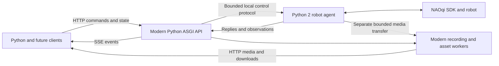

# Runtime and event transport design

Status: architecture and implementation direction, 6 November 2026. The maintained-base Python/ASGI split is implemented for increment 1; see [implementation evidence](implementation-status.md). Physical robot behavior and Apple Silicon acceptance remain separate gates. Media, motion and sequences below describe later increments.

The [original container experiment](runtime-experiment.md) and [maintained-base comparison](inverted-packaging-experiment.md) provide executable packaging and IPC evidence for Linux amd64. It exercises the complete pinned candidate dependency set beside the real SDK; the production increment-1 suite adds API/agent supervision and HTTP/SSE conformance. Physical robot behavior and Apple Silicon acceptance remain separate gates.

## Two processes, one container

| Modern API process | Legacy robot agent |
| --- | --- |
| HTTP/SSE and public contract validation | Bundled SDK loading and native service connections |
| Sessions, resource ownership, operation history/idempotency | Native callbacks and service-scoped task handles |
| Server-side sequence/parallel scheduling and cancellation coordination | Narrow typed command dispatch, native completion/cancel adapters |
| State cache, freshness classification, event fan-out | Shared physical state acquisition and receipt/source timestamps |
| Asset quotas/retention/checksums, recording lifecycle, media serving | Native camera/audio acquisition and bounded data transfer |
| Explicit recovery requests | Generation checks, expiry enforcement, stop/hold and fencing acknowledgement |

The agent is an adapter, not a second public API or arbitrary NAOqi/Python execution service. Its protocol enumerates the supported primitive actions and observations. The modern process remains authoritative for public semantics; the agent repeats constraints needed at dispatch time, such as generation, expired deadlines, setpoint order, joint bounds, and validity of native handles.

Keep those checks narrow: validate the command envelope, finite values, cached discovered limits, authority/order/deadline, and service/handle ownership at the native boundary. Do not reproduce public defaults, profile expansion, sequence validation, or resource policy in Python 2. Use portable fixtures and a versioned capability snapshot to keep boundary checks consistent with the modern process. Generation, sequence, and TTL alone do not establish that a numeric target or native handle is valid.

One agent owns the robot, and one API process owns its public state. Do not start multiple independent API workers with duplicated sessions or resource tables. Use asynchronous HTTP/event handling and bounded workers for blocking file/codec work. A lightweight supervisor manages both processes and shutdown/restart; the deployment remains one container per robot, with no broker requirement.

## Why modern Python first

The API workload is chiefly protocol/state coordination and I/O. Modern Python offers typed domain models, async I/O, schema tooling, and the same testing/tooling ecosystem as the initial client. Start with an ASGI application; FastAPI/Starlette with Uvicorn is the candidate stack to pin and prove in 1A. Keep the canonical OpenAPI/JSON schemas independent of framework-generated models, and test for drift. Heavy encoding or checksumming must not block the event loop.

Rust is a credible alternative: explicit ownership and a suitably linked binary can simplify some deployment constraints. It does not remove distributed-state, cancellation, native-task, or robot-disconnect problems, and a future Rust client does not require a Rust server. We should not add a second modern implementation language solely for hypothetical throughput. Reconsider Rust if the Python stack cannot be packaged reproducibly beside the SDK, or measured resource/latency constraints justify the cost.

The [FastAPI concurrency documentation](https://fastapi.tiangolo.com/async/) describes async request handling; the project's [SSE](https://fastapi.tiangolo.com/tutorial/server-sent-events/) and [WebSocket](https://fastapi.tiangolo.com/advanced/websockets/) documentation establish that either transport is available in the candidate modern stack. These establish available mechanisms, not benchmark results for NAO Bridge.

## Selected packaging and fallback

Use a pinned Ubuntu 24.04 base with the original Python 2 interpreter, SDK and required legacy libraries in a private prefix, alongside a separately pinned modern Python/ASGI runtime. The [maintained-base experiment](inverted-packaging-experiment.md) passes the full Linux amd64 integration suite, binary dependency audit and synthetic media execution. Adopt that direction for production integration; keep the proven legacy-base recipe as a comparison reference. Apple Silicon and real-robot validation remain open 1A gates.

The old Ubuntu Flask package was a deliberate workaround for unavailable legacy PyPI dependencies. The new recipe copies the working Python 2/SDK binary environment from an immutable donor stage without installing from PyPI, and omits Flask and unrelated application packages. Preserve the exact interpreter ABI initially; a Python 2 rebuild is a separate change requiring the same tests.

Keep `PYTHONPATH`, `LD_LIBRARY_PATH`, and interpreter selection isolated between processes. Only the legacy agent receives SDK/private-library paths, including aliases for the SDK's versioned SONAMEs. Both processes use the maintained base's glibc and loader; do not copy an old glibc into the image. The configured non-root user passes the experiment. Production mounts and callback networking still need validation.

Pin and record the base/donor digests, interpreter archive, modern wheels, complete OS package inventory, and copied legacy library hashes/provenance. Keep package copyright files. Retain build artifacts or a repository snapshot for long-term rebuilds; an apt version lock alone does not guarantee future availability. Fetch dependencies at build time only. Refresh pins deliberately and rerun the binary/native/ASGI/IPC checks; a maintained base does not update the vendored SDK libraries or separately bundled Python runtime.

The tested modern interpreter is a [python-build-standalone](https://gregoryszorc.com/docs/python-build-standalone/main/running.html) distribution supporting dynamic extension modules, identical in both comparison images. Its compatibility is established by the actual dependency and execution tests, not just a minimum-glibc claim. Rust remains a fallback only if a measured supported-platform or resource constraint justifies it; current Linux results do not require changing languages. Do not move the public stateful API into Python 2 or add a required second container to resolve packaging issues.

## Internal protocol

Start with versioned newline-delimited JSON over a permission-restricted local Unix socket. It is private to the two supervised processes, never an exposed TCP/HTTP service. Use named messages with a bounded frame size, request ID, API/agent instance IDs, connection/control generation, action, and typed payload. Replies distinguish accepted, completed, rejected, and unknown native outcomes; notifications preserve structured values. No pickle, Python expressions, or arbitrary proxy method strings.

Maintain separate bounded control/response, observation, and bulk-media paths so a camera stream or slow client cannot prevent a stop/heartbeat. A shared file or framed binary transfer can carry bounded media using validated opaque handles; do not embed large base64 frames in command JSON. Define ownership, finalization, cancellation, size limits, and cleanup for transferred buffers/files. Public assets remain managed by the modern process.

Protocol fixtures must cover version mismatch, partial/malformed frames, unexpected EOF, request timeout after native dispatch, duplicate request IDs, stale generations, saturated queues, and agent restart. Never retransmit uncertain side-effecting native calls merely because an IPC response was lost. Translate ambiguity into the public Operation's `unknown` state.

The API grants bounded control authority tied to the current session/generation. The agent rejects old generations and expired grants before dispatch. Convert API deadlines into agent-local monotonic deadlines through a measured bounded request exchange; do not extend a TTL by a long queue delay or compare unrelated clock origins blindly. The API must retain enough request evidence to reconcile a lost reply while both process instances remain unchanged. This is not durable exactly-once execution across crashes.

For processes in the same Linux container/time namespace, the experiment confirms Python 2 `clock_gettime(CLOCK_MONOTONIC)` and Python 3 `time.monotonic()` share a clock domain. Use that explicit deployment invariant with a handshake sanity check, preserving the original absolute deadline through queues. A future split across clock domains requires measured clock translation instead.

## Expiry, failures, and recovery

- The agent independently checks interactive-control TTL and API heartbeat liveness. A session-renewal PATCH cannot extend an interactive setpoint's TTL. Tentative API-heartbeat target: every 250 ms, lost after one second; measure under representative load before release.
- Native work cannot monopolize the heartbeat/watchdog reader or priority stop path. Prove independent dispatch capacity with a blocked ordinary native call; a separate queue alone is insufficient if all calls share the same blocking lock or transport.
- On API/IPC loss, invalidate its control authority, reject queued setpoints, and attempt controlled stop/hold and cancellation of native work. If API restarts while the agent survives, require a generation handshake and reconciliation before accepting new commands.
- On agent loss, the API remains available for diagnostics, reports unknown affected operations, and invalidates old control sessions. Restarting the agent does not establish that robot-side tasks have stopped. Reconnect, discover, and reconcile before releasing affected resources.
- Robot-network loss, an agent crash, or entire-container failure can prevent a stop reaching the robot. Keep that boundary explicit; bounded finite movement remains the default Wanderer strategy.
- Explicit revocation fences old work at the agent before resource release. If a native call has already been dispatched, fencing cannot retract it. A force-release result must retain that uncertainty and identify unresolved native work; original operations do not become successful. Reject override if the dispatch boundary cannot acknowledge the generation change.

The modern process owns the recovery workflow; the agent owns evidence about native dispatch/stop. Log correlated IDs across both processes and define process/agent readiness separately from robot connectivity. Test both graceful shutdown and forced process termination in the actual combined container.

Evaluate whole-container restart as a simpler operational recovery option in 1A, but do not treat it as a replacement for these failure semantics. Pipe/socket EOF detects closure, not a frozen or deadlocked process that retains its descriptors; the experiment's frozen-API case requires an independent liveness deadline. Setpoint TTL alone does not cover other in-flight native work. A fresh container also cannot prove earlier robot-side tasks stopped, and generation fencing remains necessary for session revocation and queued work while processes are alive. The current contract retains API diagnostics after agent loss. Compare lost diagnostics/operation evidence, shutdown ordering, bounded stop attempts, and fresh-start behavior before changing that choice; do not implement two recovery modes speculatively.

API state is process-local. A fresh API instance does not reload operations, sessions, subscriptions, idempotency keys or resource ownership. There is no operation journal or data volume requirement in increment 1. Agent restarts retain only the state still held by the running API. Neither kind of restart proves that robot-side work stopped; do not automatically replay it.

## Recording acquisition and asset storage

Resolve acquisition separately for video and audio in 1A, with full recording acceptance in 4B. Prefer acquisition through NAOqi into bounded bridge-side buffers: camera images from the video-device subscription and microphone buffers through the SDK's supported callback/module mechanism. This avoids making robot filesystem access or SSH access a deployment prerequisite. Native robot-side recorders are alternatives to measure, not an automatic shortcut: a bridge Asset then requires reliable file retrieval, quota/cleanup on both machines, file-access setup, and recovery after interrupted recording or transfer. Keep robot filenames private and never infer that arbitrary robot files can be downloaded through the public API.

Start the video-format experiment with MJPEG in one explicitly selected container, with WAV as the initial audio candidate where supported. JPEG frames still need a tested encoder and a valid container muxer; this is not a promise of zero codec dependencies. Encode/mux in bounded modern-process workers, outside the event loop and priority IPC path. Test decoding and seeking in the intended applications, rate/size tradeoffs, and stream timestamps before advertising formats. H.264 is a later requirement-driven option.

Write sample recordings in the modern process from the same acquisition feed as `/state` and `state.sample`, before per-viewer coalescing or drops. A recording has its own bounded writer queue and explicit loss markers; it must not depend on an SSE subscriber keeping up.

Recordings require bounded files and retained asset metadata; select the metadata storage implementation during recording delivery rather than requiring a database now. Compute checksums incrementally while writing. Finalize/flush the file before publishing immutable metadata and a checksum-derived ETag. Handle interrupted recording files and quota accounting before admitting new recordings. Active recording files are not downloadable assets; finalized partial recordings remain explicitly partial and immutable. This storage is for requested recordings, not operation recovery.

## Retain HTTP commands and SSE events

The modern runtime removes the old Flask/WebSocket dependency obstacle. We have reconsidered the choice on API needs and retain HTTP/SSE:

- Events and sampled state flow from bridge to clients; commands already have clean HTTP admission, errors, idempotency, and operation resources.
- Reactive joint/base controls can update through persistent HTTP connections using ordered, latest-value setpoints. They do not require an event socket to become a command protocol. Test their actual update rate/latency before claiming HTTP is sufficient at arbitrary rates.
- Cameras/audio/files keep dedicated binary media paths. SSE carries neither encoded media nor large payloads.
- WebSockets would require defining command framing, acknowledgements, correlation, errors, flow control, and reconnect semantics alongside the HTTP contract. Transport choice alone solves none of session ownership or motion expiry.

No historical event replay ships in this plan. Reconnect sends readiness, an explicit gap, and current state; GET operations reconciles retained outcomes, and recordings retain sample/media data independently. SSE's standard reconnection fields do not imply server retention. Explicit session renewals remain separate from observation traffic.

Reconsider an optional WebSocket data/control channel only if measured interactive workloads need it, or a concrete full-duplex media feature is added. That would reuse the existing domain/operation/ownership semantics, not replace them. Neither WebSockets nor a second event transport is required in these four increments.

## Capacity and acceptance

Initial supported targets are eight simultaneous SSE streams, four per session, sixteen subscriptions total, and the per-stream queue bounds in the API plan. Expose actual configured limits in capabilities. Validate command acceptance, cancellation/stop, shared sampling, and renewals at that limit, with slow consumers and active media. Reject excess admission; do not merely grow threads/queues.

Async stream handling removes the assumption that each stream needs a Flask thread, but memory, sockets, native callbacks, media workers, and IPC all still need budgets. Publish measurements for the selected Python/runtime dependencies and robot/host matrix. If the target is not met, reduce and document supported limits or resolve the bottleneck before release.
