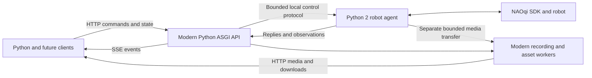

# Runtime and event transport design

Status: planned architecture, 6 November 2026. The process split is the target architecture. Modern Python is the preferred API implementation; the build and hardware experiments in delivery increment 1A must establish a reproducible deployment before broad implementation begins. No runtime changes are implemented by these documents.

## Two processes, one container

| Modern API process | Legacy robot agent |
| --- | --- |
| HTTP/SSE/auth and public contract validation | Bundled SDK loading and native service connections |
| Sessions, resource ownership, operation history/idempotency | Native callbacks and service-scoped task handles |
| Server-side sequence/parallel scheduling and cancellation coordination | Narrow typed command dispatch, native completion/cancel adapters |
| State cache, freshness classification, event fan-out | Shared physical state acquisition and receipt/source timestamps |
| Asset quotas/retention/checksums, recording lifecycle, media serving | Native camera/audio acquisition and bounded data transfer |
| Operator recovery authorization/audit | Generation checks, expiry enforcement, stop/hold and fencing acknowledgement |

The agent is an adapter, not a second public API or arbitrary NAOqi/Python execution service. Its protocol enumerates the supported primitive actions and observations. The modern process remains authoritative for public semantics; the agent repeats constraints needed at dispatch time, such as generation, expired deadlines, setpoint order, joint bounds, and validity of native handles.

One agent owns the robot, and one API process owns its public state. Do not start multiple independent API workers with duplicated sessions or resource tables. Use asynchronous HTTP/event handling and bounded workers for blocking file/codec work. A lightweight supervisor manages both processes and shutdown/restart; the deployment remains one container per robot, with no broker requirement.

## Why modern Python first

The API workload is chiefly protocol/state coordination and I/O. Modern Python offers typed domain models, async I/O, schema tooling, and the same testing/tooling ecosystem as the initial client. Start with an ASGI application; FastAPI/Starlette with Uvicorn is the candidate stack to pin and prove in 1A. Keep the canonical OpenAPI/JSON schemas independent of framework-generated models, and test for drift. Heavy encoding or checksumming must not block the event loop.

Rust is a credible alternative: explicit ownership and a suitably linked binary can simplify some deployment constraints. It does not remove distributed-state, cancellation, native-task, or robot-disconnect problems, and a future Rust client does not require a Rust server. We should not add a second modern implementation language solely for hypothetical throughput. Reconsider Rust if the Python stack cannot be packaged reproducibly beside the SDK, or measured resource/latency constraints justify the cost.

The [FastAPI concurrency documentation](https://fastapi.tiangolo.com/async/) describes async request handling; the project's [SSE](https://fastapi.tiangolo.com/tutorial/server-sent-events/) and [WebSocket](https://fastapi.tiangolo.com/advanced/websockets/) documentation establish that either transport is available in the candidate modern stack. These establish available mechanisms, not benchmark results for NAO Bridge.

## Packaging proof and fallback

Preserve the legacy SDK and its working system dependencies. The old Ubuntu Flask package was a deliberate workaround for unavailable legacy PyPI dependencies; the process split permits removing Flask after HTTP has moved, without replacing the SDK environment.

First evaluate a pinned relocatable Python distribution in a separate prefix in the legacy image, with locked modern dependencies installed at image build time. Keep `PYTHONPATH`, `LD_LIBRARY_PATH`, and interpreter selection isolated between processes; a global SDK library-path setting must not contaminate the modern interpreter. Do not install modern packages into system Python 2 or download dependencies at container startup.

[python-build-standalone's runtime documentation](https://gregoryszorc.com/docs/python-build-standalone/main/running.html) lists a glibc 2.17 minimum for most GNU/Linux targets and Ubuntu 14.04 among compatible systems. That is a promising packaging route, not proof that the complete API dependency set works. Verify the exact distribution, TLS libraries, compiled extensions, CPU target, and wheels inside the actual image on both supported host topologies. A fully static Python build is not a universal shortcut: those distributions cannot load dynamic extension modules.

If that approach fails, record the failure and test an isolated compatible runtime/library bundle or a Rust API binary built for the legacy container's actual requirements. Rust supports selectable C-runtime linkage, but dependency/system-library assumptions still need checking. See the [Rust linkage reference](https://doc.rust-lang.org/reference/linkage.html#static-and-dynamic-c-runtimes). Do not silently revert to putting the full stateful API in Python 2 or add a required second container. Close 1A with a measured runtime decision and immutable build inputs before proceeding to 1B.

## Internal protocol

Start with versioned newline-delimited JSON over a permission-restricted local Unix socket. It is private to the two supervised processes, never an exposed TCP/HTTP service. Use named messages with a bounded frame size, request ID, API/agent instance IDs, connection/control generation, action, and typed payload. Replies distinguish accepted, completed, rejected, and unknown native outcomes; notifications preserve structured values. No pickle, Python expressions, or arbitrary proxy method strings.

Maintain separate bounded control/response, observation, and bulk-media paths so a camera stream or slow client cannot prevent a stop/heartbeat. A shared file or framed binary transfer can carry bounded media using validated opaque handles; do not embed large base64 frames in command JSON. Define ownership, finalization, cancellation, size limits, and cleanup for transferred buffers/files. Public assets remain managed by the modern process.

Protocol fixtures must cover version mismatch, partial/malformed frames, unexpected EOF, request timeout after native dispatch, duplicate request IDs, stale generations, saturated queues, and agent restart. Never retransmit uncertain side-effecting native calls merely because an IPC response was lost. Translate ambiguity into the public Operation's `unknown` state.

The API grants bounded control authority tied to the current session/generation. The agent rejects old generations and expired grants before dispatch. Convert API deadlines into agent-local monotonic deadlines through a measured bounded request exchange; do not extend a TTL by a long queue delay or compare unrelated clock origins blindly. The API must retain enough request evidence to reconcile a lost reply while both process instances remain unchanged. This is not durable exactly-once execution across crashes.

## Expiry, failures, and recovery

- The agent independently checks interactive-control TTL and API heartbeat liveness. A session-renewal PATCH cannot extend an interactive setpoint's TTL. Tentative API-heartbeat target: every 250 ms, lost after one second; measure under representative load before release.
- Native work cannot monopolize the heartbeat/watchdog reader or priority stop path. Prove independent dispatch capacity with a blocked ordinary native call; a separate queue alone is insufficient if all calls share the same blocking lock or transport.
- On API/IPC loss, invalidate its control authority, reject queued setpoints, and attempt controlled stop/hold and cancellation of native work. If API restarts while the agent survives, require a generation handshake and reconciliation before accepting new commands.
- On agent loss, the API remains available for diagnostics, reports unknown affected operations, and invalidates old control sessions. Restarting the agent does not establish that robot-side tasks have stopped. Reconnect, discover, and reconcile before releasing affected resources.
- Robot-network loss, an agent crash, or entire-container failure can prevent a stop reaching the robot. Keep that boundary explicit; bounded finite movement remains the default Wanderer strategy.
- Operator revocation fences old work at the agent before resource release. If a native call has already been dispatched, fencing cannot retract it. A force-release result must retain that uncertainty and identify unresolved native work; original operations do not become successful. Reject override if the dispatch boundary cannot acknowledge the generation change.

The modern process owns the recovery workflow; the agent owns evidence about native dispatch/stop. Log correlated IDs across both processes and define process/agent readiness separately from robot connectivity. Test both graceful shutdown and forced process termination in the actual combined container.

## Retain HTTP commands and SSE events

The modern runtime removes the old Flask/WebSocket dependency obstacle. We have reconsidered the choice on API needs and retain HTTP/SSE:

- Events and sampled state flow from bridge to clients; commands already have clean HTTP admission, errors, idempotency, and operation resources.
- Reactive joint/base controls can update through persistent HTTP connections using ordered, latest-value setpoints. They do not require an event socket to become a command protocol. Test their actual update rate/latency before claiming HTTP is sufficient at arbitrary rates.
- Cameras/audio/files keep dedicated binary media paths. SSE carries neither encoded media nor large payloads.
- WebSockets would require defining command framing, acknowledgements, correlation, errors, flow control, and reconnect semantics alongside the HTTP contract. Transport choice alone solves none of session ownership or motion expiry.

No historical event replay ships in this plan. Reconnect sends readiness, an explicit gap, and current state; GET operations reconciles retained outcomes, and recordings retain sample/media data independently. SSE's standard reconnection fields do not imply server retention. Explicit session renewals remain separate from observation traffic.

Reconsider an optional WebSocket data/control channel only if measured interactive workloads need it, or a concrete full-duplex media feature is added. That would reuse the existing domain/operation/ownership semantics, not replace them. Neither WebSockets nor a second event transport is required in these four increments.

## Capacity and acceptance

Initial supported targets are eight simultaneous SSE streams, four per session, sixteen subscriptions total, and the per-stream queue bounds in the API plan. Expose actual configured limits in capabilities. Validate command acceptance, cancellation/stop, shared sampling, and renewals at that limit, with slow consumers and active media. Reject excess admission; do not merely grow threads/queues.

Async stream handling removes the assumption that each stream needs a Flask thread, but memory, sockets, native callbacks, media workers, and IPC all still need budgets. Publish measurements for the selected Python/runtime dependencies and robot/host matrix. If the target is not met, reduce and document supported limits or resolve the bottleneck before release.
